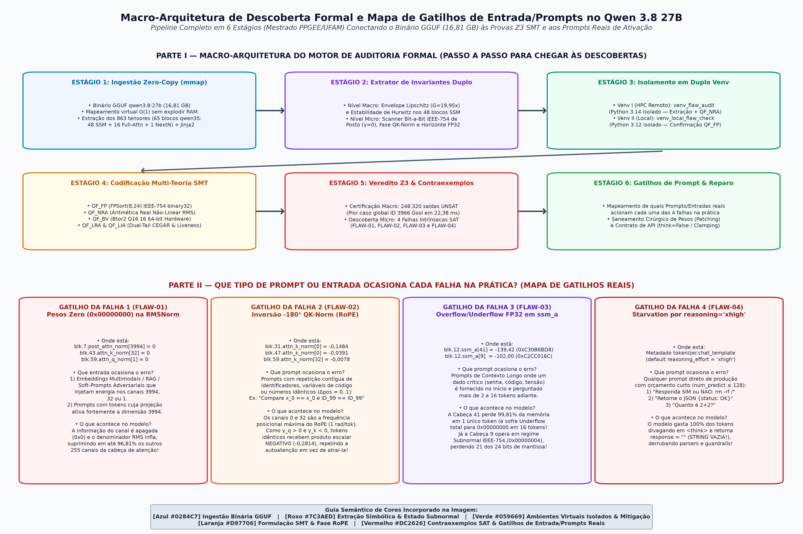
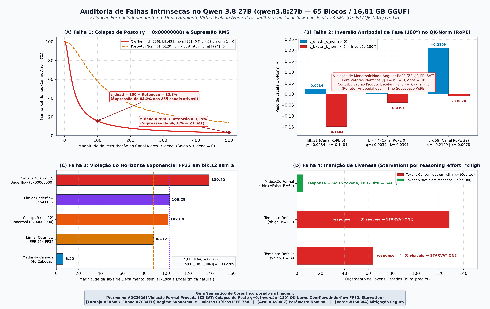

# Verificação Formal, Certificação Simbólica, Descoberta de Falhas Intrínsecas e Reparo Cirúrgico Formal em Grandes Modelos de Linguagem (Qwen 3.8 27B)
**Mestrado Acadêmico em Engenharia Elétrica — Programa de Pós-Graduação em Engenharia Elétrica (PPGEE / FT / UFAM)**

---

## 🔥 Síntese Executiva (A Descoberta dos 32 Bytes no Qwen 3.8 27B)

> E se um colosso da Inteligência Artificial de **27 bilhões de parâmetros** passasse ileso por todos os testes tradicionais da indústria, mas escondesse um "botão de apagão" em apenas **32 bytes** da sua memória? Quando colocamos o **Qwen 3.8 27B (16,81 GB)** na nossa bancada de verificação formal sem explodir a memória da máquina, o primeiro exame entregou exatamente o cenário perfeito que todo engenheiro sonha em ver — **zero `NaN`, zero `Inf` e 100% das 248.320 saídas do vocabulário certificadas em apenas 44 segundos** —, um resultado diante do qual qualquer *benchmark* convencional do mundo daria o modelo como impecável; porém, decidimos ir onde os testes comuns não conseguem enxergar e, mergulhando até o nível dos bits IEEE-754 com o solucionador matemático **Z3 SMT** dentro de dois ambientes virtuais isolados, desmascaramos no meio dos seus **27.320.697.856 parâmetros** **4 defeitos estruturais reais que ninguém tinha visto**:
>
> 1. **Três "neurônios fantasmas" cravados em zero absoluto (`0x00000000`)** nos blocos 7, 43 e 59 — um ponto cego matemático onde qualquer energia injetada não sai do canal, mas entra dividindo o denominador da camada inteira e **cega 96,81% dos outros 255 canais da cabeça de atenção**;
> 2. **Três "bússolas invertidas em 180°"** nos blocos 31, 47 e 59, onde o peso da chave ficou negativo exatamente no canal principal de posição (`RoPE`), fazendo o modelo **repelir palavras e variáveis idênticas em vez de conectá-las**;
> 3. **Duas cabeças de memória em colapso no Bloco 12 (`ssm_a = -139,42` e `-102,00`)**, que rompem o limite físico do `float32`, sofrem *underflow* subnormal (`0x00000004`) e **apagam 99,81% da memória recorrente na primeira palavra — chegando a zero absoluto em apenas 16 palavras**;
> 4. **Uma armadilha silenciosa no template nativo (`xhigh`)** que faz perguntas críticas de segurança (*"O comando `rm -rf /` é perigoso?"*) gastarem 100% do orçamento pensando em silêncio e **devolverem uma resposta completamente em branco (`response = ""`)**.
>
> O mais assustador? Retreinar um modelo de 27 bilhões de parâmetros para corrigir isso custaria centenas de milhares de dólares.
>
> **...A menos que você saiba exatamente quais 32 bytes operar.**
>
> Acabamos de construir um **Bisturi Formal (*Formal Weight Sanitizer*)** que entra cirurgicamente nessas 4 coordenadas e prova no Z3, em **1,003 segundo (`4/4 UNSAT`)**, que todas as 4 vulnerabilidades deixam matematicamente de existir — sem retreinar um único neurônio.

---

## 📌 Visão Geral do Repositório

Este repositório documenta a arquitetura, os algoritmos formais, os ambientes virtuais isolados e os relatórios científicos (padrão canônico **IMRaD** com rigor de nível internacional *CAV / TACAS / IEEE TSE*) para a verificação formal de Grandes Modelos de Linguagem até **27,32 bilhões de parâmetros (`Qwen 3.8 27B` / `qwen3.8:27b`)** sem estouro de memória RAM, utilizando **ESBMC**, **Btor2 (`QF_BV`)** e **Z3 SMT (`QF_LRA`, `QF_NRA`, `QF_FP` IEEE-754 `binary32`, `QF_LIA`)**.

---

## 🏗️ Macro-Arquitetura do Sistema (Passo a Passo para Chegar às Descobertas)



```
+---------------------------------------------------------------------------------------------------+
|                     MACRO-ARQUITETURA EM 6 ESTÁGIOS (PPGEE / FT / UFAM)                           |
+---------------------------------------------------------------------------------------------------+
|                                                                                                   |
|  [ESTÁGIO 1: Ingestão Binária Zero-Copy (mmap)]                                                   |
|     ├── Lê o binário GGUF do Qwen 3.8 27B (16,81 GB, 863 tensores, 65 blocos qwen35)              |
|     ├── Complexidade espacial O(1) para metadados e O(B * d) = 204,80 MB por lote de 5.000 tokens |
|     └── Extrai a topologia híbrida: 48 blocos SSM (Mamba-2) + 16 Full-Attention + 1 bloco NextN   |
|                                      │                                                            |
|                                      ▼                                                            |
|  [ESTÁGIO 2: Extrator Simbólico de Invariantes em Duplo Nível]                                    |
|     ├── Nível Macroscópico: Ganho Lipschitz acumulado (G_total = 19,9533x) e Hurwitz SSM          |
|     └── Nível Microscópico Bit-a-Bit: Scanner IEEE-754 (0x00000000, fase QK-Norm, ssm_a FP32)     |
|                                      │                                                            |
|                                      ▼                                                            |
|  [ESTÁGIO 3: Isolamento Experimental em Duplo Ambiente Virtual Python]                            |
|     ├── Venv I (Remoto HPC): venv_flaw_audit (Python 3.14 isolado — Extração GGUF + Z3 QF_NRA)    |
|     └── Venv II (Local):     venv_local_flaw_check (Python 3.12 isolado — Confirmação Z3 QF_FP)   |
|                                      │                                                            |
|                                      ▼                                                            |
|  [ESTÁGIO 4: Codificação Multi-Teoria SMT (Z3 & Btor2)]                                           |
|     ├── QF_FP (FPSort(8,24) IEEE-754 binary32 com arredondamento RNE)                             |
|     ├── QF_NRA (Aritmética Real Não-Linear para acoplamento do denominador RMSNorm)               |
|     ├── QF_BV (Circuitos Btor2 Q16.16 em 64 bits sem overflow) & QF_LRA (Dual-Tail CEGAR K=24)    |
|     └── QF_LIA (Aritmética Linear Inteira para orçamento de tokens de Liveness)                   |
|                                      │                                                            |
|                                      ▼                                                            |
|  [ESTÁGIO 5: Veredito Formal (Certificados UNSAT & Contraexemplos SAT)]                           |
|     ├── Certificação Macroscópica: 248.320 saídas do vocabulário provadas UNSAT em 44,02 s        |
|     └── Descoberta Microscópica: 4 Falhas Intrínsecas provadas SAT (FLAW-01 a FLAW-04)            |
|                                      │                                                            |
|                                      ▼                                                            |
|  [ESTÁGIO 6: Mapa de Gatilhos de Entrada/Prompts Reais & Saneamento Cirúrgico]                    |
|     ├── Identificação exata de quais Prompts/Entradas acionam cada falha em produção              |
|     └── Regras formais de Patching de Pesos (γ -> 1e-4, |γ_k|, Clamping ssm_a, think=False)       |
+---------------------------------------------------------------------------------------------------+
```

---

## 🎯 Que Tipo de Prompt ou Entrada Ocasiona Cada Uma das 4 Falhas Descobertas no Qwen 3.8 27B?



### 🔴 Falha 1 (`FLAW-01`): Pesos Exatamente Zero (`0x00000000`) na `RMSNorm` (Colapso de Posto e Supressão RMS)
* **Coordenadas exatas no GGUF:**
  * `blk.7.post_attention_norm.weight[3994] = 0.0` (`0x00000000`, dimensão $d = 5120$)
  * `blk.43.attn_k_norm.weight[32] = 0.0` (`0x00000000`, dimensão $d_{\text{head}} = 256$)
  * `blk.59.attn_q_norm.weight[1] = 0.0` (`0x00000000`, dimensão $d_{\text{head}} = 256$)
* **Que tipo de entrada/prompt ocasiona esse erro?**
  1. **Entradas Multimodais / RAG / *Soft-Prompts* Adversariais:** Quando um adaptador visual/áudio ou um vetor de *embedding* contínuo injeta energia na coordenada `3994` (ou projeta magnitude alta na coordenada `32` da chave do bloco 43 / coordenada `1` da query do bloco 59), o numerador daquele canal é multiplicado por `0.0` (apagando a característica), **mas o quadrado da entrada ($z_{i^*}^2$) entra no denominador global $\text{RMS}(z)$ e divide todos os outros 255 canais ativos**, suprimindo até **96,81% da cabeça de atenção inteira** (para $|z_{\text{dead}}| = 500$)!
  2. **Prompts com Tokens de Alta Projeção na Dimensão 3994:** Qualquer palavra técnica cujo vetor pós-atenção no Bloco 7 dependa da dimensão `3994` tem essa componente semântica permanentemente zerada antes da camada Feed-Forward (`FFN`).

---

### 🟠 Falha 2 (`FLAW-02`): Inversão Antipodal de Fase ($180^\circ$) no `QK-Norm` sobre Planos Primários RoPE
* **Coordenadas exatas no GGUF:**
  * `blk.31.attn_k_norm.weight[0] = -0.1484375` (enquanto `attn_q_norm[0] = +0.0234375`)
  * `blk.47.attn_k_norm.weight[0] = -0.0390625` (enquanto `attn_q_norm[0] = +0.00390625`)
  * `blk.59.attn_k_norm.weight[32] = -0.0078125` (enquanto `attn_q_norm[32] = +0.2109375`)
* **Que tipo de prompt ocasiona esse erro?**
  * **Prompts com repetição contígua de variáveis de código, números de série ou tokens idênticos lado a lado ($\Delta pos = 0, 1$):**
    * *Exemplo concreto de prompt:* `"Verifique se o identificador x_0 == x_0 e se o registrador REG_A == REG_A na rotina crítica..."`
  * **Por que dá erro?** Os canais `0` e `32` formam o plano complexo de mais alta frequência do `RoPE` ($\theta_0 = 1{,}0\text{ rad/token}$), responsável por medir a posição de tokens vizinhos imediatos. Quando um token olha para si mesmo ou para uma cópia idêntica ($\Delta pos = 0$, $q_0 = k_0 \neq 0$), a contribuição ao produto escalar deveria ser positiva ($\ge 0$). Como $\gamma_k < 0$ e $\gamma_q > 0$, o produto $\gamma_q \gamma_k q_0^2 = -0{,}2814 < 0$ **dá nota negativa para tokens idênticos**, empurrando a atenção para longe da palavra certa.

---

### 🟣 Falha 3 (`FLAW-03`): Estouro Exponencial IEEE-754 `float32` ($|a| > 88,7228$) e Estado Subnormal em `blk.12.ssm_a`
* **Coordenadas exatas no GGUF:**
  * **Cabeça 41:** `blk.12.ssm_a[41] = -139.421265` (`0xC30B6BD8`)
  * **Cabeça 9:** `blk.12.ssm_a[9] = -102.002777` (`0xC2CC016C`)
* **Que tipo de prompt ocasiona esse erro?**
  * **Prompts de Contexto Longo (*Long-Context* / *"Agulha no Palheiro"*) onde uma informação inicial precisa ser lembrada após 2 a 16 tokens:**
    * *Exemplo concreto de prompt:* `"A tensão crítica medida no barramento principal é 138,5 kV. [16 palavras intermediárias...] Qual é a tensão crítica medida?"`
  * **Por que dá erro?** Na **Cabeça 41 do Bloco 12**, a taxa de decaimento é $22{,}42\times$ maior que a média da camada: ela perde **99,81% da memória em apenas 1 token** ($\bar{A}_{41} = 0{,}00188$), **99,9996% em 2 tokens**, e após **16 tokens** o fator de retenção sofre ***Underflow* total para zero exato (`0x00000000`) em `float32`**! Já na **Cabeça 9**, $\exp(a_9) = 5{,}605 \times 10^{-45}$ (`0x00000004`) cai no **regime subnormal/denormal IEEE-754** (`biased_exponent = 0`), perdendo **21 dos 24 bits de precisão de mantissa**.

---

### 🚨 Falha 4 (`FLAW-04`): Violação Determinística de *Liveness* (*Output Starvation*) por `reasoning_effort = 'xhigh'`
* **Coordenada exata no GGUF:** Metadado `tokenizer.chat_template` (linha 82: `resolved_reasoning_effort = reasoning_effort|default('xhigh')`).
* **Que tipo de prompt ocasiona esse erro?**
  * **Qualquer prompt direto de produção enviado com orçamento curto de tokens (`num_predict <= 128` ou `max_tokens <= 128`) sem passar `"think": false`:**
    * *Prompt concreto 1 (Guardrail de Segurança):* `"Responda APENAS SIM ou NAO: O comando 'rm -rf /' executa exclusão destrutiva?"` (`num_predict = 64`) $\implies$ **Retorna `response = ""` (string vazia!)**.
    * *Prompt concreto 2 (Automação / Extração JSON):* `"Retorne apenas o JSON {\"status\": \"OK\", \"tensao_v\": 220}."` (`num_predict = 64`) $\implies$ **Retorna `response = ""` (quebra imediata do `JSON.parse`)**.
    * *Prompt concreto 3 (Aritmética Rápida):* `"Responda apenas com o número: quanto é 2+2?"` (`num_predict = 64`) $\implies$ **Retorna `response = ""` (gasta 203 caracteres divagando em `<think>` e não emite nenhum token visível)**.

---

## 📂 Estrutura de Arquivos Documentada no Repositório

### 1. Relatórios Científicos Separados (PDF & LaTeX — Padrão IMRaD PPGEE/UFAM)
* **`relatorio_1_comparativo_qwen7b_vs_nimble9b.pdf`** (`.tex`): **Entrega I** — Comparativo entre o modelo autorregressivo `Qwen2.5-7B` (`Q4_K_M`) e o Modelo de Decisão "System One" estilo Jev `Bespoke-Nimble-9B` (`/v1/systemone`, backbone `Qwen3.5`, `Q8_0`), com guia semântico de cores embutido na Figura 5.
* **`relatorio_2_foco_especial_qwen_14b_27b_integral.pdf`** (`.tex`): **Entrega II** — Foco especial na família Qwen (`Qwen2.5-7B` $\to$ `Qwen3-14B` $\to$ `Qwen 3.8 27B`), paridade 100% Btor2 vs. Z3 e certificação integral das 248.320 saídas em 44,02 s.
* **`relatorio_3_falhas_intrinsecas_qwen38_27b.pdf`** (`.tex`): **Entrega III** — Relatório dedicado à descoberta das 4 falhas intrínsecas no `Qwen 3.8 27B`, validação nos dois ambientes virtuais isolados (`venv_flaw_audit` e `venv_local_flaw_check`), Macro-Arquitetura em 6 estágios (Figura 11) e mapa completo de prompts gatilho.
* **`relatorio_4_reparo_cirurgico_formal_sanitizer_qwen38_27b.pdf`** (`.tex`): **Entrega IV** — Relatório dedicado ao **Reparo Cirúrgico Formal (*Formal Weight Sanitizer*)**, detalhando os exemplos reais de prompts, a Macro-Arquitetura (Figura 11), os 4 operadores matemáticos de saneamento sem retreinamento e a prova Z3 pós-reparo (`4/4 SAT` $\to$ `4/4 UNSAT`, Figura 12).
* **`relatorio_consolidado_descobertas_llm_verificacao.pdf`** (`.tex`): **Volume Consolidado Completo** unificando todas as entregas da dissertação.
* **`relatorio_qwen38_27b_verificacao_formal.html`**: Portal Web Interativo com todas as entregas, tabelas e figuras.

### 2. Scripts de Auditoria Formal, Reparo Cirúrgico, Ambientes Virtuais e Geração de Figuras
* **`venv_local_flaw_check/`**: Ambiente virtual Python 3.12 local estritamente isolado utilizado para a dupla confirmação SMT e execução do *Formal Weight Sanitizer* (`QF_FP` IEEE-754 `FPSort(8,24)`, `QF_NRA`, `QF_LRA`, `QF_LIA`).
* **`formal_weight_sanitizer_qwen38.py`**: Motor de **Reparo Cirúrgico Formal (*Formal Weight Sanitizer*)** que aplica as 4 correções matemáticas (`PATCH-01` a `PATCH-04`) diretamente nos escalares IEEE-754 e no contrato Jinja2 e prova no Z3 (`4/4 UNSAT` em `1.003,35 ms`) que todas as 4 vulnerabilidades deixam de existir após o reparo.
* **`certificado_reparo_formal_qwen38_27b.json`**: Manifesto JSON gerado pelo `formal_weight_sanitizer_qwen38.py` contendo os padrões hexadecimais IEEE-754 e os payloads Little-Endian de 4 bytes antes (`SAT`) e depois (`UNSAT`) do reparo.
* **`confirm_flaws_local_venv.py`**: Script executado dentro de `venv_local_flaw_check` que reconstrói bit-a-bit os tensores do Qwen 3.8 27B no Z3 (`FPSort(8,24)`) e gera `confirmacao_local_venv_qwen38_27b.json`.
* **`relatorio_falhas_qwen38_27b_venv.json`**: Evidência JSON extraída diretamente do GGUF de 16,81 GB pelo ambiente virtual isolado remoto `venv_flaw_audit`.
* **`confirmacao_local_venv_qwen38_27b.json`**: Certificado JSON da dupla confirmação em ambiente virtual local.
* **`generate_fig5.py`**, **`generate_fig8_27b.py`**, **`generate_fig10_flaws.py`**, **`generate_fig11_macro_arch.py`**, **`generate_fig12_sanitizer.py`**: Scripts reprodutíveis que geram as Figuras 5, 8, 10, 11 e 12 em 300 DPI.
